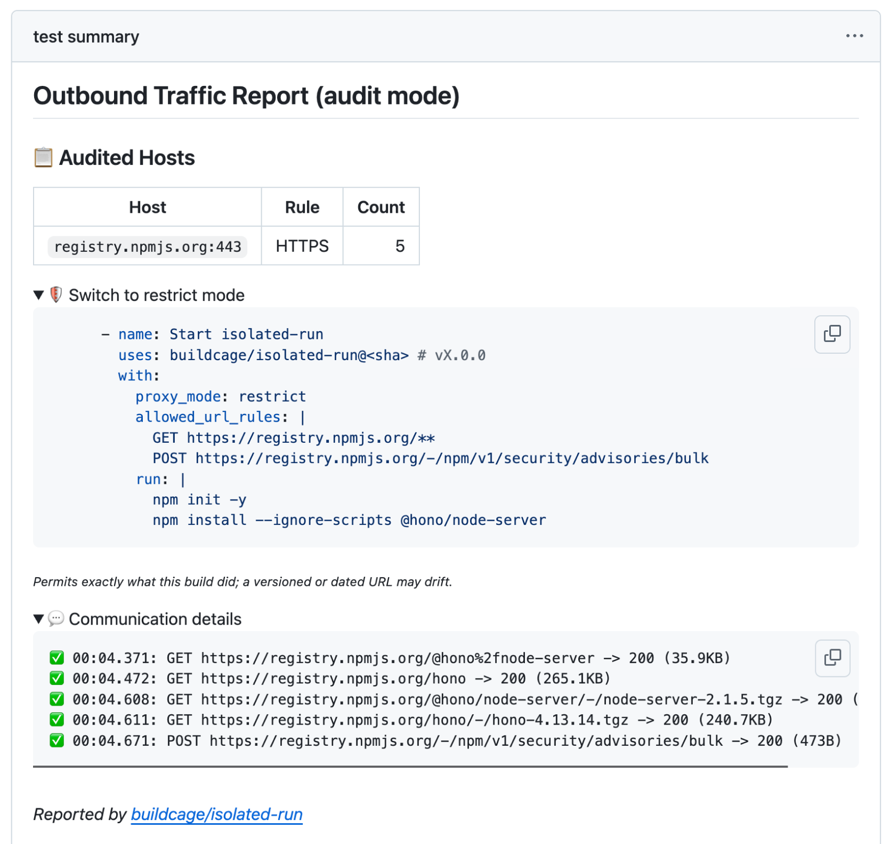
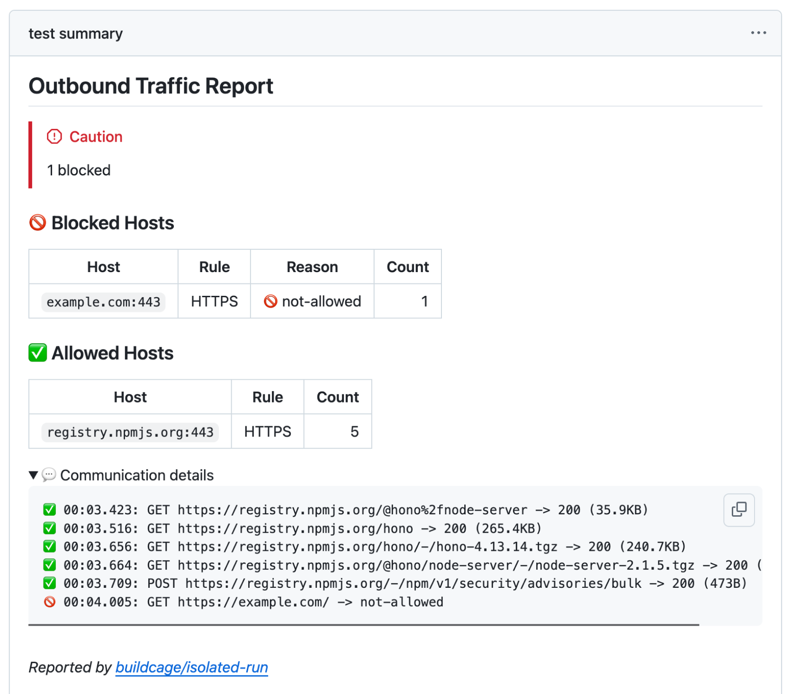

# Buildcage for `run:` Steps


[](https://github.com/buildcage/isolated-run)
[](https://github.com/marketplace/actions/buildcage-for-run-steps)


A workflow `run:` step, and every tool and dependency it invokes, can connect anywhere on the
network. Buildcage runs the command behind an allowlist: it reaches only the destinations you name,
and anything else is blocked and reported.

- The command doesn't change: no proxy to configure, no certificate to install, and it runs as the
  same user with the same `$HOME` as the rest of the job, so credentials, caches and toolchains set
  up by earlier steps keep working.
- Run once in [`audit`](#operation-modes) mode and the report writes the allowlist for you, ready to
  paste back into the step.
- A rule can name an HTTP method and a URL, inside TLS as well, so a step can fetch a package from a
  registry without being able to publish one to it.
- It all runs inside your GitHub Actions job, with no agent and no external service.

See [buildcage.github.io](https://buildcage.github.io/) for what it does and why. To isolate a
Docker build's `RUN` steps rather than a workflow step, use
[Buildcage for Docker](https://github.com/buildcage/docker).

## Contents

- [Requirements](#requirements)
- [Usage](#usage)
- [How `run` is executed](#how-run-is-executed)
- [Engines](#engines)
- [Inputs](#inputs)
- [The report](#the-report)
- [Filesystem access](#filesystem-access)
- [Filesystem audit](#filesystem-audit)
- [AWS access key check](#aws-access-key-check)
- [How it works](#how-it-works)
- [CA trust and compatibility](#ca-trust-and-compatibility)
- [Scope](#scope)
- [Limitations](#limitations)
- [FAQ](#faq)
- [GitHub's native egress firewall](#githubs-native-egress-firewall)
- [Documentation](#documentation)

## Requirements

This action sets up its isolation directly on the runner host (via `sudo -n`), so it needs a Linux
runner with passwordless `sudo` and a working Docker installation:

- **GitHub-hosted**
  - `ubuntu-latest`, the versioned `ubuntu-*` images, and their `-arm` variants
  - Lightweight images such as `ubuntu-slim` are not supported: they ship a Docker client with no
    daemon
- **Self-hosted**
  - Docker Engine 25.0 or later, with Compose v2.20.2 or later
  - Rootful Docker. The sandbox joins the proxy container's network namespace through the path
    Docker reports for it (`NetworkSettings.SandboxKey`), which under rootless Docker or
    `userns-remap` may live in a mount namespace of its own, out of the host's reach.
  - `/var/tmp` reached without a symlink, since runc refuses a sandbox root whose path goes through
    one. Otherwise the step fails before writing anything there, saying where `/var/tmp` resolves.
  - For `filesystem-mode: ephemeral`, overlayfs support on the runner's own filesystem, checked by
    a probe before the step. It fails where the runner itself runs in a container whose root
    filesystem is overlayfs, since an overlay's `upperdir` cannot sit on overlayfs, and where the
    sudoers scope does not allow `sudo rm -rf`.
  - A non-root runner user. The sandbox keeps the runner's own uid, and as uid 0 it refuses to start:
    filesystem permissions alone can't separate the command from root-owned host sockets. Don't run
    the runner as root (`RUNNER_ALLOW_RUNASROOT`).
  - Docker's `docker-credential-*` helpers installed outside `$GITHUB_WORKSPACE`, `$HOME`, `/tmp`,
    `$RUNNER_TEMP` and `write-through:`, so the command can't plant one; see
    [What it can write](./docs/security.md#what-it-can-write)

A runner that falls short fails while the proxy starts, before the command runs.

## Usage

Wrap the command you want to isolate with this action instead of a plain `run:` step. Run once in
[`audit`](#operation-modes) mode to collect what the command reaches, then switch to `restrict`. The
examples below use the default `inspect` engine; [Engines](#engines) covers the choice between the two.

### 1. Find out what the command reaches

```yaml
- name: Discover what the command reaches
  uses: buildcage/isolated-run@e17dbc9c53e03b39835b2f3e11834243d90aa183 # v2.5.0
  with:
    proxy-mode: audit # Log every destination, block nothing
    run: |
      npm ci
      npm test
```

The step writes every destination the command contacted to the Job Summary:



Its **Switch to restrict mode** section holds the allowlist, already written out from what the
command actually did. A request whose method, host or path a rule would read as a wildcard is listed
under it rather than written in, since copying it would permit more than was sent. The step it
writes also keeps `filesystem-mode`, `write-through` and `filesystem-audit` when the run set them,
from a config file too, as it names no `config-file`. It leaves out `expected-filesystem-rules`,
with a comment to add the step's back.

### 2. Enforce the allowlist

Paste that allowlist into the step and switch the mode:

```yaml
- name: Run tests with outbound network isolation
  uses: buildcage/isolated-run@e17dbc9c53e03b39835b2f3e11834243d90aa183 # v2.5.0
  with:
    proxy-mode: restrict
    allowed-url-rules: |
      GET https://registry.npmjs.org/**
      POST https://registry.npmjs.org/-/npm/v1/security/advisories/bulk
    run: |
      npm ci
      npm test
```

Each rule names the methods it permits, so these let npm install packages without letting it publish
any: `npm publish` is a `PUT` to the same host, which no rule here covers.



A blocked connection fails the step, so a command that starts reaching somewhere new doesn't pass
unnoticed.

### Example workflows

Each pair runs a command in audit, then in restrict with the rules audit reported and one request
they block: `inspect` on an npm install ([audit](.github/workflows/example-inspect-audit.yml) ·
[restrict](.github/workflows/example-inspect-restrict.yml)), `universal` on a Maven build
([audit](.github/workflows/example-universal-audit.yml) ·
[restrict](.github/workflows/example-universal-restrict.yml)).

A separate
[ephemeral filesystem example](.github/workflows/example-ephemeral-filesystem.yml) shows which
writes survive a `filesystem-mode: ephemeral` step and which the overlay discards, and the
[filesystem audit example](.github/workflows/example-filesystem-audit.yml) records what an npm
install touches, and its
[`expected-filesystem-rules` counterpart](.github/workflows/example-filesystem-audit-expected.yml)
shows only what falls outside a baseline taken from it. The AWS access key check runs against a real
AWS account
([audit](.github/workflows/example-aws-key-check-audit.yml) ·
[restrict](.github/workflows/example-aws-key-check-restrict.yml)), assuming a role and blocking a
key the step was not given.

## How `run` is executed

`run` runs under `bash -e`, the same as a native `run:` step without `shell:`. To use another
interpreter, start `run` with a shebang line; the script is then run as written, with no `set -e`
added:

```yaml
- uses: buildcage/isolated-run@e17dbc9c53e03b39835b2f3e11834243d90aa183 # v2.5.0
  with:
    run: |
      #!/usr/bin/env python3
      print("hello")
```

`shell:`, `working-directory:` and the workflow's `defaults.run` do not apply to a `uses:` step, so
they have no effect here. Use a shebang and `cd` instead.

### Passing values to `run`

Use the step's own `env:` (not a `with:` input) to pass values into `run`, exactly like a native
`run:` step. The action forwards its process environment into the isolated command, so anything set
via `env:` is available there too:

```yaml
- uses: buildcage/isolated-run@e17dbc9c53e03b39835b2f3e11834243d90aa183 # v2.5.0
  env:
    PR_TITLE: ${{ github.event.pull_request.title }}
  with:
    run: |
      echo "Building for: $PR_TITLE"
      npm test
```

Avoid interpolating `${{ }}` expressions directly into `run` itself (e.g.
`run: echo "${{ github.event.pull_request.title }}"`). GitHub substitutes them into the script text
before any shell runs, so an attacker-controlled value (a PR title, branch name, issue body) can
inject arbitrary commands. Passing the same value through `env:` instead means it reaches the
isolated command as a single environment variable, never interpreted as shell syntax. This is the
same
[script injection guidance](https://docs.github.com/en/actions/security-guides/security-hardening-for-github-actions#understanding-the-risk-of-script-injections)
GitHub gives for any workflow, and applies to this action's `run` input exactly as it would to a
native `run:` step.

## Engines

`proxy-engine` selects how closely the command's traffic is examined.

|                                               | `inspect`<br>terminates TLS, checks method and URL         | `universal`<br>reads the SNI only, checks host and port |
| --------------------------------------------- | ---------------------------------------------------------- | ------------------------------------------------------- |
| A rule can say                                | `GET\|HEAD https://registry.npmjs.org/**`                  | `registry.npmjs.org:443`                                |
| Allow a fetch, block a publish, same host     | ✅                                                         | -                                                       |
| The report shows                              | Every request with its URL                                 | Host and port                                           |
| The command's TLS                             | Terminated and re-signed with a CA generated for that step | Untouched                                               |
| Certificate pinning, or a bundled trust store | -                                                          | ✅                                                      |

Start with `inspect`, and fall back to `universal` when something the command runs won't accept the
mounted CA. `inspect` is the default value of `proxy-engine`, so `universal` has to be set
explicitly.

Both intercept at the network level, so a tool that ignores `HTTP_PROXY` is covered either way, and
both use the same sandbox and the same network boundary.

## Inputs

`run` is the only required input, and the ones below are the rules you write by hand. The full list,
with defaults and the engines each input applies to, is in
[Reference](./docs/reference.md#action-inputs), and the grammar those rules are written in is in
[Rule syntax](./docs/reference.md#rule-syntax).

Use `label` to tell several steps' report sections apart when the action appears more than once in a
job.

The inputs can also be kept in a YAML file in the repository, named by `config-file`. See
[Config file](./docs/reference.md#config-file).

A `#` starts a comment at the start of a line or after whitespace, so a group of rules can carry a
heading or a rule can carry its reason. It works the same in every rule input. `write-through` takes
only whole-line `#` comments, since a path may contain a `#`.

### Operation modes

`proxy-mode: audit` logs every destination the command reaches and blocks nothing. `restrict`, the
default, allows only what the rules match and blocks and logs everything else. Start with `audit`
when you first adopt Buildcage or when a dependency changes, and keep `restrict` for everyday runs.

If you forget a domain the command needs, `restrict` blocks it and the step fails with the
destination named. Run `audit` first to find those domains.

`audit` also lets a connection made straight to an address through. Under `universal` that includes
cloud metadata (`169.254.169.254`) and the runner's own addresses; `inspect` still blocks those
unless a rule names the address as its host.

### Rules for the `inspect` engine

`allowed-url-rules` is the one to reach for. Each line is a method list, a space, and a URL pattern.
`*` stays inside one domain label or path segment, `**` crosses dots and slashes, and a rule with no
path allows any path on that host:

```yaml
allowed-url-rules: |
  # npm: fetch packages, and the audit endpoint it posts to
  GET https://registry.npmjs.org/**
  POST https://registry.npmjs.org/-/npm/v1/security/advisories/bulk

  # pip: one registry, two domains
  GET https://pypi.org/simple/**
  GET https://files.pythonhosted.org/packages/**

  # a private registry is an ordinary host
  GET|HEAD https://registry.internal.example.com:8443/**
```

`allowed-tls-rules` passes a TLS destination through undecrypted, judged on its SNI and port. It is
for TLS that isn't HTTPS, and for the hosts an `inspect` step must not decrypt:

```yaml
allowed-tls-rules: |
  db.example.com:5432
  repo.maven.apache.org:443
```

`allowed-ip-rules` covers connections made straight to an address, which never go through DNS. A
rule may be an address, a CIDR block or a wildcard, on either engine:

```yaml
allowed-ip-rules: |
  192.168.1.10:443
  10.0.0.0/8:443
```

A step that calls AWS APIs needs more than URL rules; see
[AWS access key check](#aws-access-key-check).

### Rules for the `universal` engine

`universal` never decrypts, so rules name a host and a port. `allowed-https-rules` and
`allowed-http-rules` split by scheme, and `allowed-ip-rules` works as it does under `inspect`:

```yaml
allowed-https-rules: |
  # npm and maven
  registry.npmjs.org:443
  repo.maven.apache.org:443
  *.internal.example.com:443  # everything on the internal network

allowed-http-rules: |
  deb.debian.org:80

allowed-ip-rules: |
  192.168.1.10:443
```

### Destinations you expect to stay blocked

A noisy dependency, or a domain you are deliberately keeping off the allowlist to confirm it stays
blocked, belongs in `known-blocked-rules`. Those rows move to the report's collapsed **Known Blocked
Hosts** and stop failing the step, and the destination stays unreachable:

```yaml
known-blocked-rules: |
  telemetry.example.com
```

A name blocked at resolution, before any connection, has no port. A bare `telemetry.example.com` (or
`telemetry.example.com:*`) covers it; `telemetry.example.com:443` does not, since no port was involved.

One rule per line, and on `inspect` a line can also be a URL rule (a method and a URL, the
`allowed-url-rules` syntax) to acknowledge a single endpoint on a host whose other traffic is
allowed, such as a telemetry POST to an API you otherwise use:

```yaml
known-blocked-rules: |
  POST https://api.example.com/telemetry
```

Any other blocked request to that host still fails the step. See
[Blocked rules](./docs/reference.md#blocked-rules-known-blocked-rules) for the full syntax.

## The report

Every step appends its own section to the Job Summary: the hosts it reached, the ones it was blocked
from, and, in `audit`, the allowlist to switch to `restrict` with. An alert under its title counts
what needs a look. With the [filesystem audit](./docs/filesystem-audit.md) on, a **Filesystem
Activity Report** section follows the report.

Under `inspect` a **Communication details** section lists every request in order with its method,
URL, status and size, so a blocked entry names the URL that was attempted rather than a bare host.
A query parameter that names a credential has its value replaced, see [Credentials in a
URL](docs/security.md#credentials-in-a-url).

In `restrict` mode a blocked connection fails the step, and so does a report that could not be read
or written, since it can't show that nothing was blocked. Set `fail-on-blocked: false` to report
without failing, or list what you expect to stay blocked in `known-blocked-rules`. In `audit` mode
nothing fails the step. How the alert and the tables are made up, and what a
`dns-service-not-allowed` row means, is in [Report details](./docs/reference.md#report-details).

`upload-traffic-artifact: true` uploads the whole timeline as a `traffic.json`, one row per request
and per name lookup, with the method, URL, status, size and the address it resolved to. It is
uploaded even when the step fails. Under `universal` it omits the method, URL, status and resolved
address that only `inspect` sees. The fields are listed in
[Reference](./docs/reference.md#traffic-artifact).

## Filesystem access


Only `$GITHUB_WORKSPACE`, `$HOME`, `/tmp`, and `$RUNNER_TEMP` are writable by default. Every other
path is remounted read-only for the duration of the `run` command. What the command can _read_ is
not restricted. The build CA in the figure is the `inspect` engine's, and it is mounted after every
writable path, so a `write-through:` entry cannot take the sandbox's CA trust with it.

`filesystem-mode` controls what happens to those writes once the step ends:

| `filesystem-mode`          | What it does                                                                                                                                                                        |
| -------------------------- | ----------------------------------------------------------------------------------------------------------------------------------------------------------------------------------- |
| `persistent` (default)     | Writes to `$GITHUB_WORKSPACE`/`$HOME`/`/tmp`/`$RUNNER_TEMP` stay on the host after the step ends, as they would without the sandbox.                                                |
| `ephemeral` (experimental) | Every writable path is discarded when the step ends (via an overlay). A host mount under one gets an overlay of its own, with [exceptions](./docs/reference.md#ephemeral-overlays). |

`write-through:` names the paths whose writes reach the real host filesystem in either mode, the
paths that opt out of whichever default applies:

| `filesystem-mode` | What `write-through:` does                                               |
| ----------------- | ------------------------------------------------------------------------ |
| `persistent`      | Makes the path writable, on top of the four always-writable paths above. |
| `ephemeral`       | Exempts the path from the overlay, so writes to it survive the step.     |

`filesystem-mode` only decides what happens to writes the sandbox is already allowed to make. It
never widens that set: `ephemeral` does not make a read-only path writable. Neither mode changes
file ownership. The sandboxed command runs as the runner's own user with every capability dropped
and `no_new_privileges` set, so `sudo` and setuid binaries do nothing for it. A path the runner user
could not write outside the sandbox stays unwritable inside it.

If `run` needs to write somewhere else in `persistent` mode, a build output or a tool-specific cache
directory for example, list it under `write-through:`:

```yaml
- uses: buildcage/isolated-run@e17dbc9c53e03b39835b2f3e11834243d90aa183 # v2.5.0
  with:
    write-through: |
      /opt/some-tool/cache
    run: some-tool build
```

How an entry is resolved, which paths are reserved, what `write-through: /` does, and what happened
to the old `writable:` and `allow_write:` inputs are all in
[Reference](./docs/reference.md#write-through-paths).

> [!WARNING]
> `write-through: /` is for trusted code only. Against a compromised command it gives up the
> outbound restriction as well as the read-only one: all of `/run` and `$XDG_RUNTIME_DIR` are
> reachable again, a `systemd --user` bus included, which starts a process outside the sandbox. The
> commands this action runs on the host after the command are not kept out of writable paths either.
> See [The `/` opt-out](./docs/reference.md#the--opt-out).

<a id="filesystem_mode-ephemeral"></a>

### `filesystem-mode: ephemeral`

> [!WARNING]
> `filesystem-mode: ephemeral` is **experimental**: its behavior, inputs, and error messages may still
> change in a future release without following semver, and it has seen less real-world use than the
> rest of this action. `persistent` (the default) is unaffected and stays stable. Try `ephemeral` in
> a non-critical workflow first, and pin this action to a commit SHA rather than a version tag if you
> adopt it.

Use `filesystem-mode: ephemeral` when the command is untrusted and you want to stop it from planting
something a later, non-isolated step in the same job would pick up: a rewritten `~/.bashrc`,
`~/.npmrc`, `~/.docker/config.json`, or a `$GITHUB_OUTPUT` edit meant to run code once the sandbox
is gone.

```yaml
- uses: buildcage/isolated-run@e17dbc9c53e03b39835b2f3e11834243d90aa183 # v2.5.0
  with:
    filesystem-mode: ephemeral
    filesystem-audit: record # record what the command touches while discarding its writes
    write-through: |
      $GITHUB_OUTPUT
      ./dist
    run: npm ci && npm run build && npm test
```

> [!NOTE]
> Discarding those writes is the point, but the same overlay also drops output the command was meant
> to produce. `$GITHUB_OUTPUT` and `$GITHUB_STEP_SUMMARY` live under `$RUNNER_TEMP`, so whatever the
> command writes to them is gone once the step ends unless `write-through:` names that file or a
> directory it is in. Naming `$GITHUB_STEP_SUMMARY` puts the command's markdown in the same Job
> Summary this action writes its own report to. That report and the `traffic-artifact-name` and
> `filesystem-audit-artifact-name` outputs are unaffected either way: all are written from the runner
> host after the sandboxed command has exited, outside the overlay. A `$GITHUB_OUTPUT` kept this way
> is trimmed to the entries the runner can read, and a dropped entry fails the step.

Name only what a later step needs, usually the build output; the [filesystem
audit](./docs/filesystem-audit.md#choosing-write-through) shows where the command wrote. Everything
else the command writes is discarded, the rest of `$GITHUB_WORKSPACE` included: an edited
`package.json` script, a new `.git/hooks` entry, a patched file under `node_modules`. If a later
step needs `node_modules` or another part of the workspace, name it too. A named path is as
exposed as in `persistent` mode, since a later step may run or ship what lands there, and an output
set through `$GITHUB_OUTPUT` is untrusted as in
[Passing values to `run`](#passing-values-to-run) above.

### What stays read-only

`$GITHUB_ENV`, `$GITHUB_PATH` and `$GITHUB_STATE` stay read-only in either mode, although they sit
under `$RUNNER_TEMP`; see [`write-through` paths](./docs/reference.md#write-through-paths).

The runner's install directory, its `_actions` directory holding every action's checkout, and the
docker CLI's config directory (`$DOCKER_CONFIG`, else `~/.docker`) stay read-only too, since the
runner and this action run code from them after the command exits. A command that writes docker
config (`docker login`, `gcloud auth configure-docker`) needs a step of its own. The exceptions, and
what this means for a self-hosted runner's `_work`, are in
[Runner directories](./docs/reference.md#runner-directories).

## Filesystem audit

> [!WARNING]
> `filesystem-audit` is **experimental**: its behavior, inputs, and output format may still change in
> a future release without following semver. Try it in a non-critical workflow first, and pin this
> action to a commit SHA rather than a version tag if you adopt it.

`filesystem-audit: record` records what the isolated step reads, writes, moves, deletes, changes the
attributes of, and executes, and adds a section to the Job Summary: every path it touched, by the
program and commands that touched it, with a flag for each action, and, folded below, one line per
command and path.
`upload-filesystem-audit-artifact: true` also uploads the full record as a
`buildcage-filesystem-audit-<id>` artifact; treat it as sensitive.

```yaml
- uses: buildcage/isolated-run@e17dbc9c53e03b39835b2f3e11834243d90aa183 # v2.5.0
  with:
    filesystem-audit: record
    run: npm ci
```

It only records; it never blocks an access. It works on GitHub-hosted Ubuntu runners, and on a
self-hosted runner on Linux 6.1 or newer (6.4 on arm64) with cgroup v2 and kernel BTF;
elsewhere the step fails before the command runs. With it on, a 32-bit system call in the step
kills the thread that made it, and while the step runs every system call on the host, other jobs'
included, costs a little more. See [Filesystem audit](./docs/filesystem-audit.md)
for how to use and read it.

Once a step's accesses are known, `expected-filesystem-rules` lists them, one `<program> <access>
<path>` rule per line, and the section then shows only the accesses outside them. The uploaded
artifact holds a proposed set to start from, and, once rules are set, the rules to add whenever an
access falls outside them; see [Expected accesses](./docs/filesystem-audit.md#expected-accesses).

## AWS access key check

> [!WARNING]
> `aws-key-check` and `allowed-aws-role-accounts` are **experimental**: their behavior, inputs, and
> error messages may still change in a future release without following semver.

Most AWS APIs, such as STS or CloudFormation, name no resource in the URL and reach whichever
account signs the request, so a compromised dependency could sign with its own key and send data to
its author's account. `aws-key-check: true` accepts only the key the step was given in
`AWS_ACCESS_KEY_ID`, and `allowed-aws-role-accounts` adds the keys of roles in the accounts you
name:

```yaml
- uses: aws-actions/configure-aws-credentials@<sha>
  with:
    role-to-assume: arn:aws:iam::111111111111:role/deploy
    aws-region: us-east-1
- uses: buildcage/isolated-run@e17dbc9c53e03b39835b2f3e11834243d90aa183 # v2.5.0
  with:
    proxy-mode: audit # shows what restrict would block
    aws-key-check: true
    run: aws ecs update-service --cluster app --service web --force-new-deployment
```

Then switch to `restrict` with the rules the report's **Switch to restrict mode** example writes. A
step that assumes roles of its own, as the CDK does, also names the roles' accounts in
`allowed-aws-role-accounts`. The check needs the `inspect` engine.
[AWS access key check](./docs/aws.md) covers adopting it, the block reasons, and the IAM settings
for what it cannot see.

## How it works


The step starts its own throwaway proxy container, runs the command in an isolated sandbox on the
runner, appends its report to the Job Summary, and stops the container again, all within that one
step. Traffic is caught at the network level rather than through proxy environment variables, so a
tool that ignores them is covered too, and the CA the `inspect` engine needs is mounted into the
sandbox's own view of the filesystem, never written to the runner. The figure is the `inspect`
engine; `universal` follows the same path without terminating TLS, and so needs no CA.

Using the action several times in one job gives each step its own allowlist, including when the
steps run concurrently through GitHub Actions' `background`/`wait`/`wait-all`/`parallel` keywords:
the proxy container, network, and Compose project are namespaced per step, and each container
records which step started it, so concurrent steps never tear down each other's containers.

[Security Details](./docs/security.md) has the architecture of each engine and the isolation
mechanisms, with a diagram of what runs where.

## CA trust and compatibility

`proxy-engine: inspect` terminates TLS and re-signs it with a CA generated for that step, whose
private key never leaves the step's proxy container
([details](docs/security.md#the-ca-and-its-private-key)), so the command has to trust that CA. For
the step, Buildcage adds it where the common toolchains look:

- The system CA store, and on a RHEL, Fedora or SUSE runner the directory of certificates GnuTLS
  reads instead (`wget` on RHEL uses GnuTLS).
- The variables Node, Deno, OpenSSL, Python `requests` and pip read: `NODE_EXTRA_CA_CERTS`,
  `DENO_CERT`, `SSL_CERT_FILE`, `REQUESTS_CA_BUNDLE` and `PIP_CERT`, where the command's environment
  leaves them unset.
- The keystore of the JVM behind the `java` on `PATH` and of `$JAVA_HOME`, so `mvn`, `gradle` and
  `java` reach the proxy without `proxy-engine: universal`.
- The NSS database in `$HOME` that Chromium reads, including the `chrome-headless-shell` that
  Puppeteer, Playwright and Remotion download.

The store, the keystores and the NSS database are copies mounted over the sandbox's own view of
their paths, and the mounts go away with the sandbox when the step ends. How each one is done is in
[CA trust variables](./docs/reference.md#ca-trust-variables), and what this cannot cover is in
[Limitations](#under-the-inspect-engine), below.

## Scope

Buildcage controls _where_ your command can connect, not _what code_ it runs. A malicious package
delivered through an allowed domain still runs. Treat it as one layer among your other measures: if
something gets past them, it still cannot reach a destination outside the allowlist.

This action isolates the step it wraps, not the job. An output the command sets reaches later steps
unchanged, and in `persistent` mode so does anything it writes under `$HOME`, `/tmp`,
`$RUNNER_TEMP`, or `$GITHUB_WORKSPACE`: a `~/.npmrc` the command leaves still runs code in a later
npm step. Those steps run without this action's restrictions unless you wrap them too, and post
steps, which run after the last step, cannot be wrapped. If a step runs untrusted code, isolate the
steps after it in the same job as well, or move them to a separate job, and don't treat an output
an isolated step set as trustworthy. `filesystem-mode: ephemeral` with a narrow `write-through:`
keeps such files from reaching them. `$GITHUB_ENV`, `$GITHUB_PATH` and `$GITHUB_STATE` stay
read-only in either mode, and `write-through:` can open only the first two, by name (see
[What stays read-only](#what-stays-read-only)).

An allowlist also cannot stop anything leaving through a service you had to allow anyway. What it
does stop is traffic to a destination that is not on the list, and infrastructure an attacker set up
is normally not on it, because the command has no reason to reach it. That is also the hardest kind
of leak to find afterwards.

An allowlist generated from an audit run already blocks every destination the audit did not record.
Whether to go further depends on what the step has access to:
[Hardening](./docs/security.md#hardening) is what to look at when it holds credentials, personal
data, or source you do not publish. For the full threat model, see
[Security Details](./docs/security.md).

## Limitations

### What isn't covered

- `allowed-tls-rules` is not decrypted. The SNI and the port are checked, and the proxy resolves
  that name itself, so the connection reaches the host the rule named, but nothing inside the TLS
  session is seen.
- `allowed-ip-rules` is not inspected at all, and doesn't require TLS either: once an `ip:port` pair
  is allowed, any TCP-based protocol can use that path. Prefer a domain rule wherever the
  destination has a stable name.
- `universal` never sees the method or the path. They travel inside TLS, so neither is enforced and
  neither reaches the report or the traffic artifact. A request fronted behind an allowed SNI is
  invisible to it as well, while `inspect` matches on the real `Host` and blocks it. See
  [Domain fronting](./docs/security.md#domain-fronting).
- The generated allowlist covers only what the engine classified. `allowed-tls-rules` and
  `allowed-ip-rules` come back exactly as the audit run was configured with them, since nothing
  behind a passthrough was ever decrypted.

### Protocols

- UDP is dropped, so QUIC and HTTP/3 either fall back to TCP or fail. Port 53 to the proxy, which is
  the resolver, is the one exception. ICMP is dropped too.
- IPv6 is not used anywhere. The sandbox's interface toward the proxy has no IPv6 address, the
  rule syntax refuses an IPv6 address, forwarded IPv6 is dropped, and the proxy reaches allowed
  names over IPv4 only, so an allowed name with AAAA records and no A record never resolves and no
  rule can clear it.

### Service discovery

The resolver has no upstream, so it returns nothing for a discovery record: `SRV`, `TXT`, `TLSA` and
`URI` queries come back empty, and the command connects to the name a rule allowed rather than to
one a nameserver picked for it. Clients that treat `SRV` as a discovery layer fall back to the host
name itself, so the host a rule names is the host the command reaches.

What this breaks is a client with no fallback, where the record is the only way it can find the
service at all. A `mongodb+srv://` connection string is the one to expect: use `mongodb://` with the
shard hostnames written out and allowlist those instead. Active Directory and Kerberos discovery
have the same shape.

Under `inspect`, a lookup for a `_service._proto.<host>` name is reported as `discovery` when the
rules allow that host, and is not counted as blocked. A service name under any other host is
reported as blocked; see
[Blocked service names](./docs/reference.md#blocked-service-names).

### Inside the sandbox

- The isolated command cannot use Docker. If `docker`, or another container or VM runtime group, is
  the runner's primary group, it is substituted for a safe one before the command runs, and the
  host's `/run`, where the container runtimes, systemd-resolved, snapd and the rest keep their
  sockets, is covered by an empty tmpfs. See
  [Isolation mechanisms](docs/security.md#isolation-mechanisms).
- `/dev` holds the standard container device set, so a command needing a host device node such as
  `/dev/kvm` or `/dev/fuse` won't work. Open-file limits, `/dev/shm` size, and the hostname match
  the runner.
- In `persistent` mode `/tmp` and `$RUNNER_TEMP` are the same real directories for every invocation
  in the job, so two concurrent steps can reach each other's scratch files there. `ephemeral` gives
  each invocation its own overlay.
- `$XDG_RUNTIME_DIR` is missing or empty: under `/run` it does not exist, and anywhere else it is
  masked with an empty directory. A tool expecting a session keyring or its own scratch state there
  fails outright rather than landing on the host's real directory. Only naming it in
  `write-through:` brings it back.
- Each step starts and stops its own proxy container, which keeps allowlists independent and the
  report's step-to-container mapping unambiguous, at the cost of startup time on jobs with many
  isolated steps.

### Under the `inspect` engine

- A tool that pins a specific certificate, or ships a bundled trust store it never lets the system
  update, still needs `proxy-engine: universal` or an `allowed-tls-rules` passthrough, since it will
  not accept the re-signed certificate.
- A client that insists on HTTP/2 through ALPN, as gRPC clients do (grpc-go since 1.67, for one),
  fails to connect: `inspect` answers no ALPN. Pass its host through with `allowed-tls-rules`,
  which judges the SNI and port only. A client that falls back to HTTP/1.1, such as curl, works.
- Only the JDKs of the `java` on `PATH` and of `$JAVA_HOME` get the CA in their keystore. For
  another JDK on the runner, such as the one a Maven or Gradle toolchain forks tests into, set
  `JAVA_HOME` to it in the step's `env:` or use `proxy-engine: universal` for that step. A JDK the
  step itself fetches (Gradle's toolchain auto-provisioning, `sdk install`, Bazel's embedded JDK or
  `remotejdk`) is not covered either. A self-hosted runner whose only JDKs are under `$HOME` needs a
  system JDK or a `RUNNER_TOOL_CACHE` outside `$HOME`; without one, or with a keystore sealed under
  a non-default password, the step warns and a JVM build needs `proxy-engine: universal`. See
  [JVM keystores](./docs/reference.md#jvm-keystores).
- `audit` terminates TLS as well. It drops the rules, not the interception, so a tool that cannot
  accept the CA fails in `audit` exactly as it would in `restrict`. `universal`'s audit mode
  decrypts nothing and breaks nothing.
- A CA-trust variable the command's environment already sets is left alone rather than appended to,
  so a tool reading it fails TLS unless it points at the system store; the step warns about it.
  [Reference](./docs/reference.md#ca-trust-variables) lists the variables it checks.
- Chromium trusts the CA only through the NSS database under the step's own `HOME`, so leave `HOME`
  alone within the command (`HOME=/tmp chromium` does not trust it). A Chromium before M146 does not
  read `~/.local/share/pki/nssdb`, so use M146 or later where that is the database. A database the
  runner user cannot write, or one too large to copy, gets no slot, and the step warns; use
  `proxy-engine: universal` for Chromium there. Neither happens on a GitHub-hosted runner. See
  [Chromium](./docs/reference.md#chromium).
- A Firefox carrying Mozilla's own root list, such as Playwright's or the one Selenium drives, reads
  a per-profile database and does not trust the CA; use `proxy-engine: universal` or an
  `allowed-tls-rules` passthrough for it.
- A command that changes the CA's own trust in the NSS database (`certutil -M`) copies the CA into
  the runner's database, which fails the step where `filesystem-mode` would keep the write. A
  command cannot remove the database's directory (`rm -rf ~/.pki`) either, since it is a mount point
  inside the sandbox.
- The CA is added to a store that already exists, never created. A command whose filesystem has
  nothing resembling a system CA bundle at a well-known path has nothing to add to, which matters
  only to a tool that needs TLS trust for something.
- A task runner that starts each command with a filtered environment drops the CA variables before
  the command sees them. vite-plus does this for a cached `vp run` task, which keeps `NODE_OPTIONS`
  but not `NODE_EXTRA_CA_CERTS`, so Node inside it fails with `SELF_SIGNED_CERT_IN_CHAIN`. The
  system CA store the command sees holds the CA already, so have Node read that store:

  ```yaml
  - uses: buildcage/isolated-run@e17dbc9c53e03b39835b2f3e11834243d90aa183 # v2.5.0
    env:
      NODE_OPTIONS: --use-system-ca # Node 22.15+ (23.9+ on 23.x); older Node refuses to start
    with:
      run: vp run build
  ```

  Otherwise pass the variable through on the task itself, as `untrackedEnv` rather than `env`, which
  would put its value in the cache key. A task with `cache: false` keeps the whole environment.

  ```ts
  // vite.config.ts
  build: { command: "vp build", untrackedEnv: ["NODE_EXTRA_CA_CERTS"] },
  ```

### The Job Summary size cap

GitHub caps a Job Summary at 1 MiB per step, counting what the command itself wrote there, and drops
the whole summary rather than truncating it. The report is written first, and what the command
wrote is cut to fit what is left, with a note and a warning; the step does not fail. A report that
would pass the limit on its own gives up its parts in a fixed order, the `restrict` example last.
What was cut is recovered from the [traffic artifact](./docs/reference.md#traffic-artifact), or the
filesystem audit's own artifact, and is not kept anywhere when neither was uploaded. The order is in
[The Job Summary size cap](./docs/reference.md#the-job-summary-size-cap).

## FAQ

**A host only ever gets looked up, never connected to. How do I write a rule for it?**

The report gives it a row with `DNS` as the rule kind and no port. If you want it to stay
unreachable without failing the step, put the name in `known-blocked-rules`, which is the one input
where a rule may omit the port. If the command actually needs it, write an ordinary host or URL rule
and the lookup is reported as allowed.

**My step's outputs disappear under `filesystem-mode: ephemeral`.**

`$GITHUB_OUTPUT` and `$GITHUB_STEP_SUMMARY` live under `$RUNNER_TEMP`, which the overlay discards.
Name the ones the command writes to in `write-through:`. See
[Filesystem access](#filesystem-access).

**My step fails writing to `$GITHUB_ENV` or `$GITHUB_PATH` with `Read-only file system`.**

Both are read-only inside the sandbox in either filesystem mode, since what they set reaches every
later step and post step. Name the one the command writes to in `write-through:`, such as
`$GITHUB_ENV`, or hand the value to the next step through `$GITHUB_OUTPUT` and that step's `env:`.

**Can I trust the action itself?**

isolated-run relies on being verifiable rather than on being trusted. The source is open for anyone
to read at any time, and the action runs only what was built from it: each release is immutable, its
image is built from the release commit and signed, and the action verifies that before it runs.
Changing what isolated-run does means changing its public source first. See
[Image provenance verification](./docs/security.md#image-provenance-verification).

## GitHub's native egress firewall

GitHub is building an egress firewall directly into Actions runners
([technical preview](https://github.com/github-early-access/actions-native-egress-firewall) as of
September 2026): opt a job into a firewall-enabled runner image and its traffic is inspected outside
the runner VM, in `log` or `enforce` mode, from a single `.github/egress-firewall.yaml` in the
repository. Because it sits outside the VM, a workflow that gains root inside the runner cannot
switch it off. Firewall-enabled images are GitHub-hosted and Linux only.

One policy for the whole run is one allowlist for every step in it: the destinations
`actions/checkout`, the caches and the setup actions need stay open to every other step as well.
Buildcage writes a separate allowlist for the one step you don't trust, so it gets the hosts its
command needs and nothing else, and a rule there can name a method and a URL rather than only a
host. The two compose: a perimeter the job can't switch off, and a tighter policy inside it.

Buildcage also runs on any Linux runner with Docker, self-hosted included, rather than on a
firewall-enabled runner image.

## Documentation

| Doc                                            | What's in it                                                        |
| ---------------------------------------------- | ------------------------------------------------------------------- |
| [Reference](./docs/reference.md)               | Every input, the rule syntax in full, the report's own output       |
| [Filesystem Audit](./docs/filesystem-audit.md) | What `filesystem-audit` records, and how to read it                 |
| [AWS Access Key Check](./docs/aws.md)          | What `aws-key-check` stops, how to adopt it, and its block reasons  |
| [Security Details](./docs/security.md)         | Architecture and threat model for every engine, attack resistance   |
| [Development Guide](./docs/development.md)     | Working on Buildcage itself: setup, local runs, tests and the rules |

## Contributing

Contributions are welcome! Please feel free to submit issues or pull requests at
[github.com/buildcage/isolated-run](https://github.com/buildcage/isolated-run).

## Show Your Support

If you find this action helpful, please consider giving it a star ⭐ on GitHub!

## Disclaimer

This software is provided "as is", without warranty of any kind, express or implied. The authors
and contributors are not liable for any damages, losses, or security incidents arising from the
use of this software. Use at your own risk.

## License

The isolated-run source code is licensed under the MIT License. See [LICENSE](./LICENSE) file for
details.

The Docker image includes third-party components under their own licenses (GPL, Apache 2.0, ISC,
etc.). See [THIRD_PARTY_LICENSES](./THIRD_PARTY_LICENSES) for the full list.
The image carries that file, this repository's LICENSE and the license texts it points to under
`/opt/buildcage/`.

The Action bundles its npm dependencies (MIT, Apache 2.0, ISC) into the committed `dist/` files.
See [THIRD_PARTY_LICENSES_NPM](./THIRD_PARTY_LICENSES_NPM) for their license texts.
